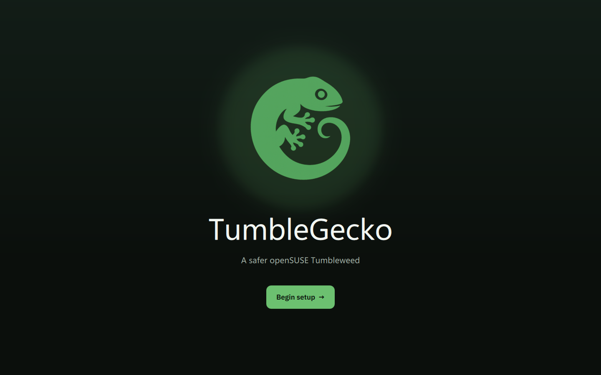
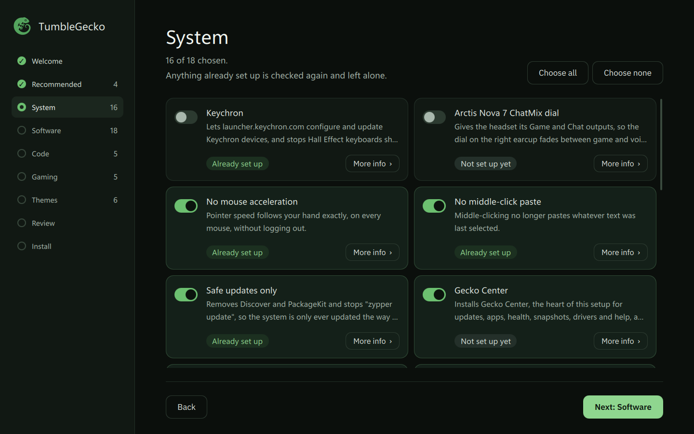
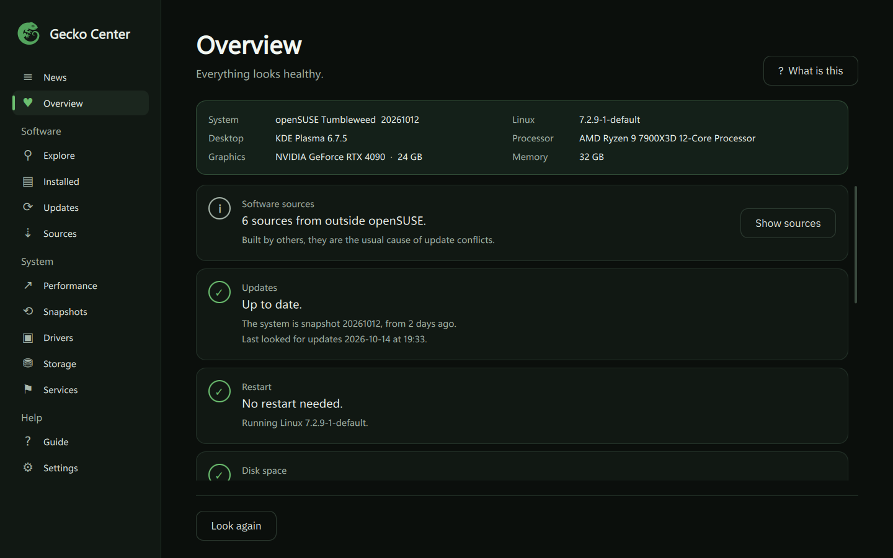
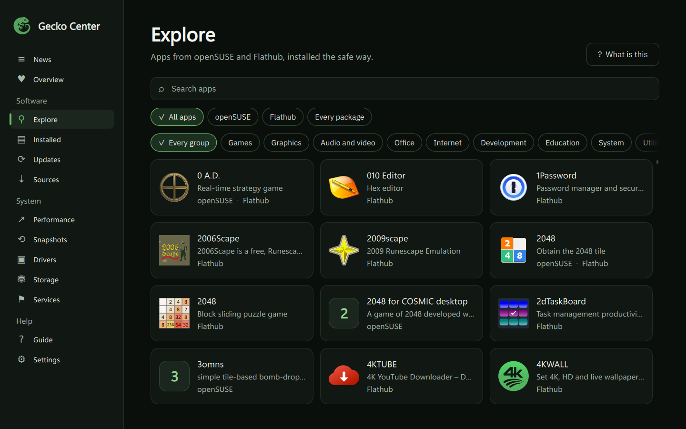
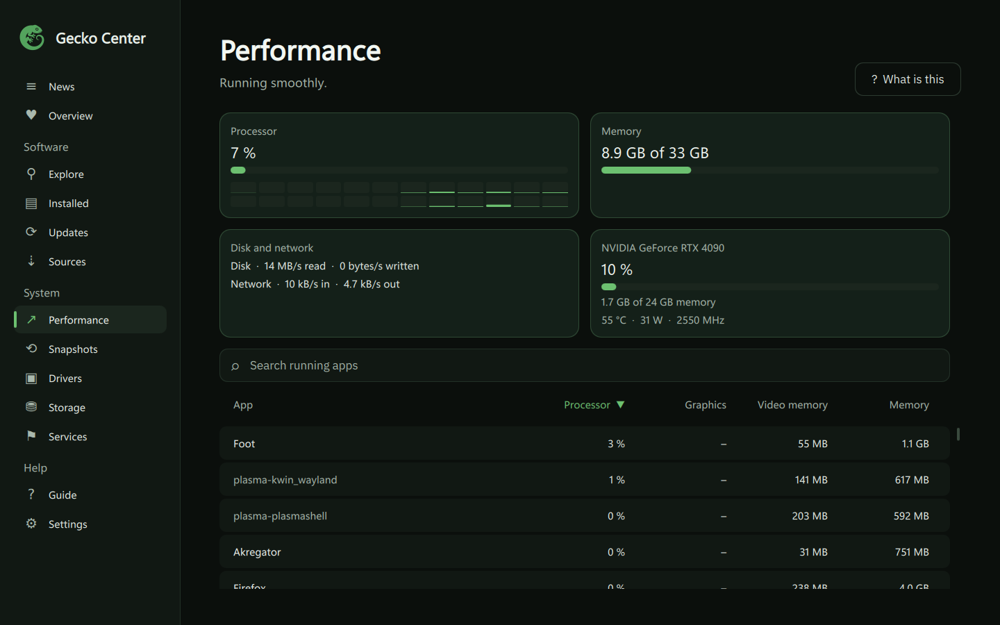

<p align="center">
  
</p>

<h1 align="center">🦎 TumbleGecko</h1>
<p align="center">A safer openSUSE Tumbleweed.<br>
Turns a fresh install into a finished KDE Plasma desktop.</p>

<p align="center">
  <a href="https://www.opensuse.org/">
    
  </a>
  <a href="https://kde.org/plasma-desktop/">
    
  </a>
  <a href="https://wayland.freedesktop.org/">
    
  </a>
</p>

## Install

<details open>
<summary>Automatic</summary>
<br>

Run this in a terminal on a fresh Tumbleweed install.

```sh
curl -fsSL https://raw.githubusercontent.com/TumbleGecko/tumblegecko/main/install.sh | bash
```

Afterwards, you'll find TumbleGecko in the app menu if you want to run the setup again.

You can also run the command again any time to replace TumbleGecko itself with the newest version.
</details>

<details>
<summary>Manual</summary>
<br>

[Download TumbleGecko](https://github.com/TumbleGecko/tumblegecko/archive/refs/heads/main.zip), extract it and double-click `setup.sh` inside.
</details>

## Why

Tumbleweed is excellent!

But a fresh install still takes an evening of tweaks and pasted commands, and one bad move breaks it.\
TumbleGecko does all the work for you and guards against the common mistakes.

<p align="center">
  
  
</p>

## What you get

All of these come with your install of TumbleGecko!

### Gecko Center

[Gecko Center](https://github.com/TumbleGecko/gecko-center) looks after the system, so you never need a terminal.\
Updates, apps, health, snapshots, drivers and help, all in one window.

<p align="center">
  
  
  
</p>

### Double-click anything

[gecko-run](https://github.com/TumbleGecko/gecko-run) starts any double-clicked program with the right tool, whether it is made for Windows or DOS.

### Crimson apps

[Crimson Code](https://github.com/Crimson-Org/crimson-code), [Crimson Text](https://github.com/Crimson-Org/crimson-text), [Crimson Pixel](https://github.com/Crimson-Org/crimson-pixel) and [Crimson Music](https://github.com/Crimson-Org/crimson-music) are the main apps for code, text, editing pictures and YouTube Music playlists.

### Guardrails

The update paths that break Tumbleweed are blocked, and drivers, codecs and Flathub are ready to go.

## How

Each thing TumbleGecko sets up is its own small file in `tasks/`, like "install VLC" or "turn off mouse acceleration".\
It checks what is already done and only touches the rest, so running it twice is safe.\
It always grabs the newest version of everything and checks each download before using it.\
[docs/design.md](docs/design.md) goes into the details.\
So if you have any suggestions on tweaks, feel free to make a pull request!
